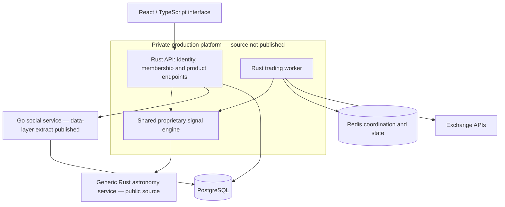

# Astradia Public

**The public engineering workspace for [Astradia](https://astradia.xyz).**

Astradia brings together personal astrology, social discovery, market research,
and trading tools. This repository makes selected interface and infrastructure
code available for review. **The proprietary signal and trading engine is
maintained separately and is not included here.**

[Architecture](docs/ARCHITECTURE.md) · [Public/private boundary](docs/PUBLIC-BOUNDARY.md) · [Reviewer guide](docs/REVIEWING.md) · [Component provenance](docs/PROVENANCE.md)

## What you can review

| Area | Included here | Relationship to the product |
| --- | --- | --- |
| React + TypeScript | SVG glyphs, account-scoped chart storage, free-access presentation, membership synchronization, contract tests | Reused product modules, with a lightweight reviewer interface |
| Rust + Axum | Standalone Swiss Ephemeris HTTP service, request validation, bounded CPU work, source distribution | The generic astronomy component used by the private platform |
| Go + PostgreSQL | Social persistence, profile preferences, friendships, mutual consent, avatars, query regression tests | An extracted data-access package; not the complete production social API |
| Integration contracts | A minimal, illustrative signal-summary contract | Shows how a client consumes results without containing the evaluation algorithm |
| Engineering documentation | Architecture, scope, provenance, and release checks | Explains the private components without publishing their implementation |

The public UI is a **runnable reviewer edition**, not a copy of the full hosted
product. Its chart positions and social profile are synthetic display fixtures.
It does not calculate trading signals, contact production APIs, accept payments,
sign in users, or place orders. No private engine binary or downloadable model
is supplied.

## Run the interface

Use Node 22.12 or newer:

```sh
cd frontend
npm ci
npm run dev
```

Open the local URL printed by Vite. Explore the chart interface, membership
presentation, consent preview, and architectural separation. No credentials or
database are required for this demo.

```sh
npm test
npm run build
```

The build deliberately has no private-service dependency and emits no source maps.

## How the production system is divided



The native API and worker share the private evaluation library. Generic sky
coordinates are inputs; the transformation into asset-specific assessments,
strategy decisions, sizing, and execution is proprietary. The browser receives
an authorized display response, not the model's internal calculation state.

Production authentication uses Privy. Payment providers notify the server,
which verifies the notification and updates membership before access is granted.
The Go service handles social features behind the Rust API. Node builds the
frontend; it is not the production API runtime. See the
[architecture guide](docs/ARCHITECTURE.md) for the boundaries and data flow.

## Explore the backend components

**Rust astronomy** — see [service instructions](services/ephemeris/README.md).
The independent service accepts time and optional coordinates and returns
positions and houses. It contains no financial scoring logic. Rust 1.94+ is
required; the lockfile and the component's license notices are included.

**Go social persistence** — see [package instructions](packages/social-store/README.md).
The extracted package uses `pgx` and parameterized queries. Its PostgreSQL
regression test checks relationship and consent visibility without loading any
production data. Go 1.25+ is required.

## Publication boundary

This repo starts with new Git history. It is not a fork or a mirror of the
private application. Only explicitly reviewed files were copied into it.

Excluded material includes scoring equations, numerical weights, decision
thresholds, calibrations, asset-specific rules, current and legacy strategies,
execution/replay logic, research outputs, private fixtures, customer records,
credentials, environment files, and compiled private artifacts.

`python3 scripts/check-public-boundary.py` checks every tracked file against the
reviewed manifest, rejects unapproved files and source imports, and detects
common secret formats. CI repeats these checks and runs a dedicated Gitleaks
scan. Install the local pre-push check with:

```sh
git config core.hooksPath .githooks
```

These checks support review; they are not a guarantee against a bad publication
decision. **Do not merge, mirror-push, or copy whole directories from the private
repository.** Follow [the publication procedure](docs/PUBLIC-BOUNDARY.md) for updates.

## Rights and contributions

This is a public, source-visible review repository. No repository-wide
open-source license is granted for Astradia-authored material; see
[COPYRIGHT.md](COPYRIGHT.md). The independent astronomy service retains its
AGPL license, the separate protocol retains its MIT license, and third-party
notices remain in their component directories.

Issues and focused pull requests about the published components are welcome.
Read [CONTRIBUTING.md](CONTRIBUTING.md) before proposing changes. Do not attach
private engine code, customer information, access tokens, or account exports.

The demo is an engineering exhibit, not trading advice or evidence of investment
performance. It includes no return claims or backtest results.
