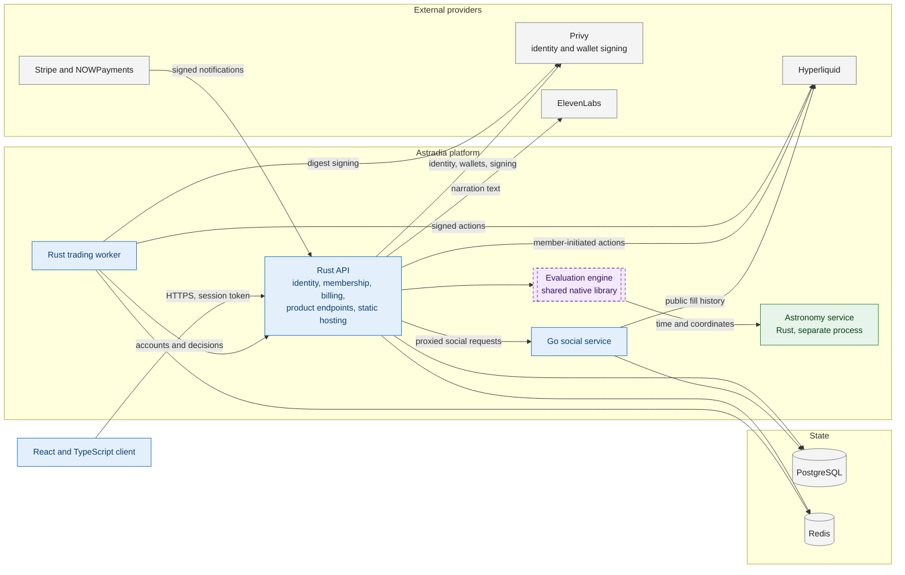
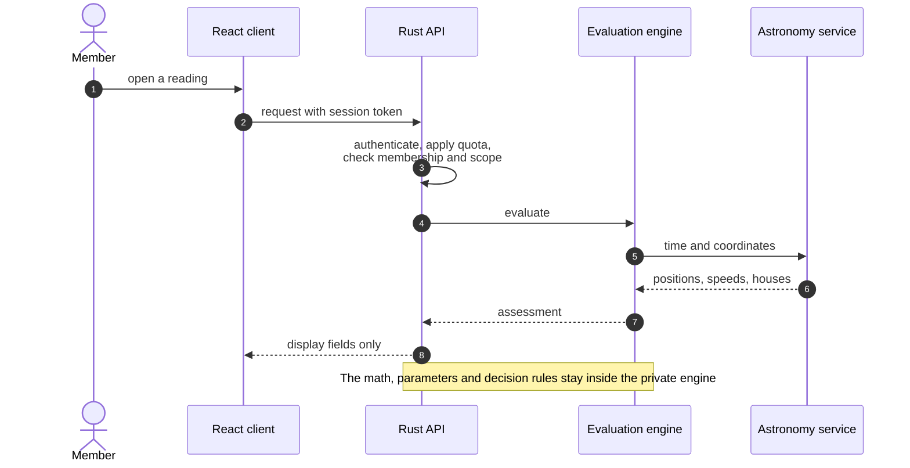
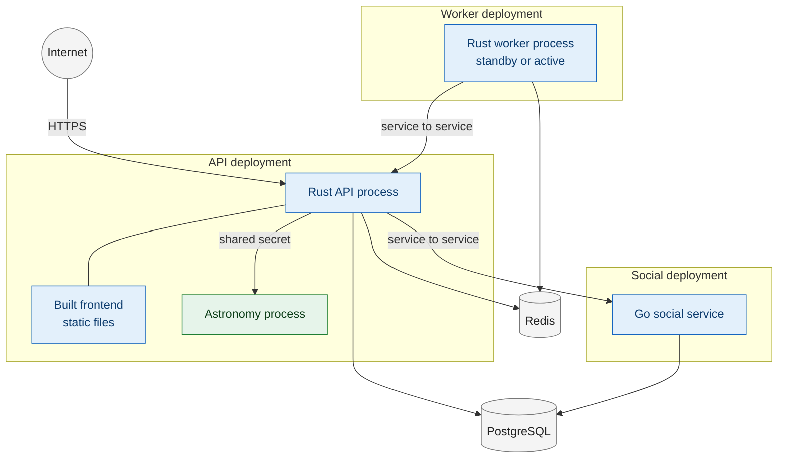
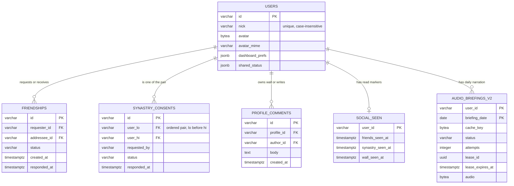
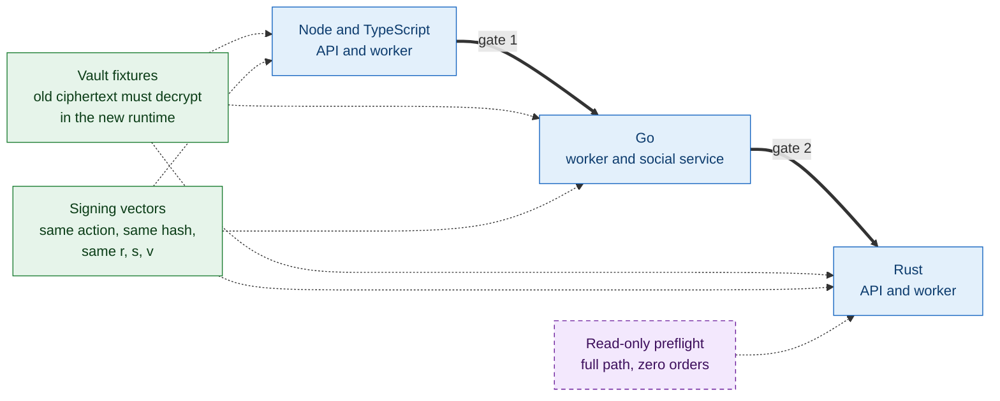
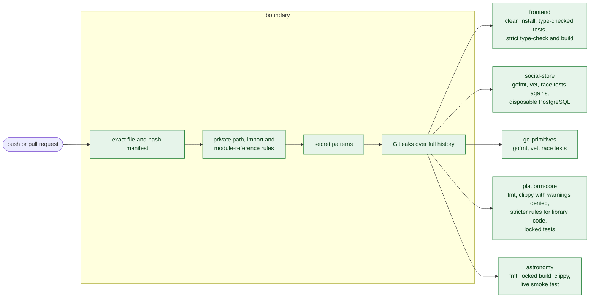

# Architecture

This document describes how Astradia's production system is put together and
which parts of it are published in this repository. Two companion documents go
deeper: the [security model](SECURITY-MODEL.md) and
[execution safety](EXECUTION-SAFETY.md).

Astradia's production application is larger than this public workspace. The
diagrams describe production responsibilities; they do not imply that the
complete production system can be started from this repo.

**Reading the diagrams.** Every diagram uses the same three colours.

| Colour | Meaning |
| --- | --- |
| Green | Source is published here in full |
| Blue | Partly published: reusable modules and primitives are here, the code that calls them is not |
| Purple, dashed | Private: described, never published |

## 1. System at a glance

The private evaluation engine runs inside the API. Generic sky coordinates are
its inputs; the transformation into asset-specific assessments, strategy
decisions, sizing and execution is proprietary. The worker does not evaluate
anything itself: it asks the API for current decisions and carries them out.
The browser receives an authorized display response, not the model's internal
calculation state.

Two processes can send a signed action to the exchange: the worker, for
automated trading, and the API, for an order, close or transfer a member
initiates in the app. A per-account lease keeps them from acting on the same
account at once.

## 2. Components and public scope

| Component | Production responsibility | Public scope |
| --- | --- | --- |
| React client | Product navigation, chart and result presentation, authenticated API calls | Reusable modules and a standalone reviewer UI in `frontend/` |
| Rust API | Authentication, membership enforcement, user data, billing, analysis, and social proxying | Primitives in `packages/platform-core`: credential envelope, payment-notification verification, membership check. Request authentication, routes, queries and billing flows are described only |
| Shared native engine | Proprietary feature evaluation, calibrated aggregation, and final signal decisions | No implementation, parameters, reference outputs, or binaries |
| Rust worker | Account coordination, private risk policy, order lifecycle and reconciliation | Coordination and signing primitives in `packages/platform-core`: leases, nonces, protocol hashing and signing. The worker loop, risk policy and exchange adapter are described only |
| Astronomy service | Generic planetary positions and house geometry | Independent service source and existing license/data notices in `services/ephemeris` |
| Go social service | Profiles, friendships, consent-aware comparisons, track record, and related product features | Social database package and schema (`packages/social-store`), credential envelope and a pure-Go position calculator (`packages/go-primitives`); comparison scoring, track-record accounting and HTTP layers excluded |
| PostgreSQL | Durable accounts, memberships, payments, preferences, and relationships | Social and audio-cache table definitions only; no database dump |
| Redis | Shared state, coordination, leases and caches | The lease, nonce, key/value, counter and queue operations in `packages/platform-core`, with bounded waits; no snapshot or deployment configuration |

## 3. Request path

1. The client requests product data using its authenticated session.
2. The Rust API checks the user's identity, membership, and requested scope.
3. The private engine combines generic astronomical inputs with its private
   evaluation logic and internal data. The math, model parameters, and decision
   rules are not part of any public package.
4. A response adapter selects the fields needed by the client. Internal evidence
   and configuration are not an API contract.
5. The worker asks the API for decisions made by that same engine, then applies
   its own private account/execution checks before interacting with an exchange.

The public `frontend/src/contracts.ts` is an **illustrative narrow boundary**,
not a promise that every production endpoint uses that exact schema. Its parser
rejects unexpected fields; the demo leaves the signal unavailable. It never
substitutes a locally re-created trading algorithm.

The published astronomy component is a separate HTTP process. It is also used
by the private platform, but it knows only time, coordinates, positions, speeds,
and houses. It does not know assets, positions, portfolio balances, or strategy
decisions. Process separation describes the implementation and is not a legal
conclusion about licensing obligations of a larger deployment. Existing
component licenses are preserved.

## 4. Deployment topology

Three deployable units share one database and one Redis instance. The API is
the public entry point; the other two are reached service to service.

- The API serves the built frontend itself. Only the compiled client is public
  on that origin; server source, engine tables and credentials never enter the
  static directory, and the frontend build fails if a browser module resolves
  into a server directory (`frontend/vite.config.ts`).
- The worker has no database connection and runs no astronomy process. It
  talks to the API as an authenticated service and keeps its coordination state
  in Redis.
- Each unit is health-checked. A new worker reports healthy while it waits in
  standby, so a rolling deploy never needs two active workers
  ([execution safety](EXECUTION-SAFETY.md#worker-lifecycle)).

## 5. Identity, membership, and social consent

Privy supplies production identity and wallet integration. Application sessions
and authorization remain server responsibilities. No production provider keys
or application IDs are required by the reviewer UI.

For payments, the production server verifies provider callbacks, binds them to
the correct account and invoice, and commits membership changes idempotently.
The browser's membership watcher only refreshes authenticated state; a return
URL or a local UI switch cannot grant server access. The verification functions
are published in `packages/platform-core/src/webhooks.rs`; checkout, pricing
and provider credentials are not.

Free access and social privacy are separate concerns. Friendship does not imply
permission to compare personal charts. Mutual consent must be checked by the
calling API. The public Go package shows how relationships and consent state
are persisted and read. It does not expose an unauthenticated HTTP interface.

The sequence and state diagrams for these flows are in the
[security model](SECURITY-MODEL.md).

## 6. Storage

PostgreSQL uses typed relational columns for identities, timestamps and other
queryable fields; JSONB is used for document-style preferences. BYTEA is used
where the data is binary, such as avatar images and encrypted credentials in
the private platform. BYTEA is a PostgreSQL type, not a Rust- or Go-specific
database. The envelope format is public in `packages/platform-core` and
`packages/go-primitives`; only synthetic test blobs are published, never a
private credential or a production ciphertext.

The tables below are the ones whose definitions are published
(`packages/social-store/migrations`, `docs/schema/audio-briefings.sql`). The
`users` row shows only the columns those migrations add.

Design choices visible in those definitions:

- A friendship is one directed row with a uniqueness constraint and a check
  that forbids a self-edge.
- A comparison consent is one row per unordered pair, enforced by an ordering
  check, so two people can never hold two contradictory consent rows.
- Birth data stays in the account row and never crosses the social API;
  friends receive computed results, never raw birth rows.
- The audio cache carries its own lease columns, so duplicate paid generation
  across replicas is prevented in the database rather than in process memory
  ([audio briefings](AUDIO-BRIEFINGS.md)). Its cache key is the raw 32-byte
  digest in a BYTEA column with a length check.

## 7. Execution safety

The worker's decisions are private; the guarantees around them are not. The
short version is below, and [execution safety](EXECUTION-SAFETY.md) has the
state machine and the order lifecycle.

- **One actor at a time.** Automated execution happens under an owner-checked
  lease with a time-to-live. During a rolling deploy the new worker starts in
  standby and keeps answering health checks until the running one releases the
  lease; a holder that dies without releasing loses it when it expires. A
  separate per-account lease covers the API's member-initiated actions.
  `packages/platform-core/src/state.rs` is that lease, implemented as single
  atomic Redis scripts.
- **Nonces never repeat.** Each signer draws from a monotonic counter that also
  survives a clock that stalls or steps backwards.
- **Signatures are checked before they are used.** A signature returned by the
  remote signing service is recovered locally and must match the expected
  wallet, so a wrong or substituted signer fails closed
  (`packages/platform-core/src/signing.rs`).
- **An uncertain write is never blindly retried.** When a submission's outcome
  is unknown, the worker reconciles with the exchange before anything else is
  sent on that market, and the pending intent survives a restart.
- **Rehearsal before cutover.** A read-only preflight copies production state
  into memory and runs each account's planning path against an exchange adapter
  that refuses every order, so nothing is signed or sent. It serves its own
  health endpoint, so a failed rehearsal is visible before a cutover.
- **Operator controls are persisted, not improvised.** Emergency actions are
  written down and carried out only by the lease-holding worker, and can only
  reduce exposure.
- **An empty store is not an all-clear.** The store carries a mark that only
  an operator writes; while it is missing, nothing adds exposure and closes
  still go out.
- **Fail closed everywhere.** A missing secret disables a route instead of
  opening it, an invalid service credential never falls through to a user
  identity, and error responses carry no request or upstream content.

## 8. Runtime migration

The backend moved from Node to Go to native Rust. The moves were designed so
that no stored credential needs re-entering and no signature changes, and each
was gated by parity fixtures rather than by inspection: ciphertext written by
one runtime must decrypt in the next, and every exchange action must hash and
sign to the same bytes. The vault fixtures and signing vectors in `packages/platform-core`
and `packages/go-primitives` are those gates. The equivalent parity fixtures
for the evaluation engine are private.

The Go social service is still in production beside the Rust API; the Go and
Node workers are retired.

## 9. Delivery and quality gates

Every push to this repository runs the pipeline below. The boundary job runs
first and everything else depends on it, so unreviewed content fails before any
build starts.

A second workflow runs when a lock file, a module file or the dependency
policy changes: cargo-audit and cargo-deny over both Rust lock files
(advisories, licenses, sources, bans), govulncheck over both Go modules
(known vulnerabilities in the code they call), and `npm audit` over the
frontend's locked packages (advisories, and the registry signature of every
installed package). The Rust exceptions are listed with their reasons in
`deny.toml` and `.cargo/audit.toml`; there are none for Go or npm.

The publication procedure itself, and what is deliberately excluded, is in
[PUBLIC-BOUNDARY.md](PUBLIC-BOUNDARY.md).

## 10. What the reviewer edition does

The frontend can be built on its own. Its chart fixture is deliberately synthetic
and its social controls update local component state only. The Go packages, the
Rust platform core and the Rust astronomy service can each be tested
independently. They are not wired into a replacement for the hosted product,
and there is no automatic connection to Astradia's production accounts or
databases.
