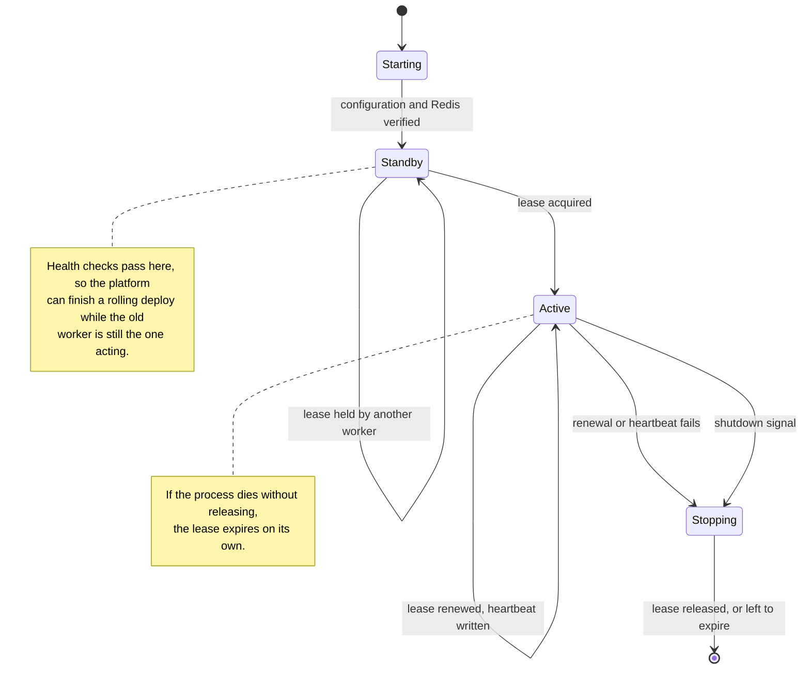
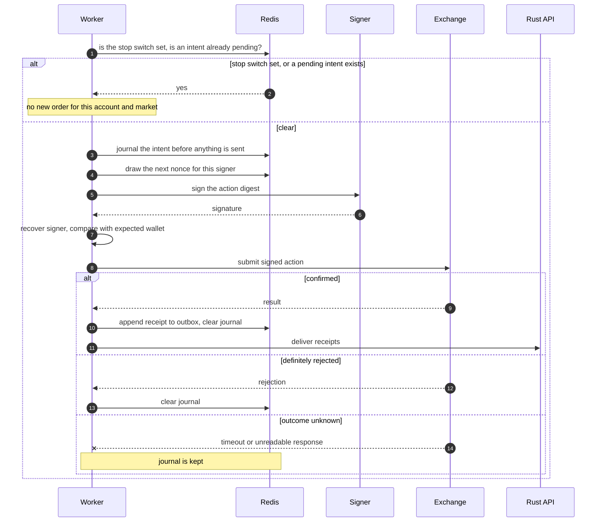
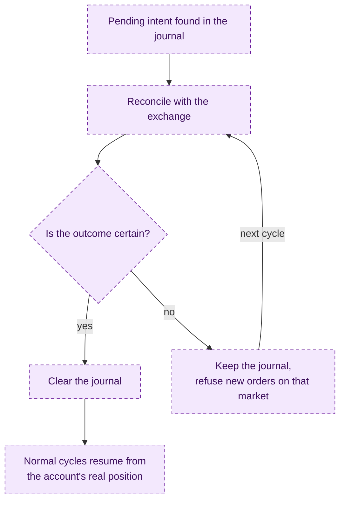
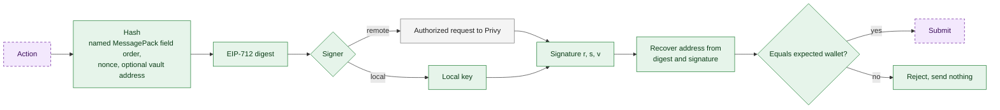
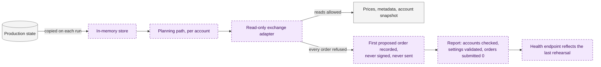

# Execution safety

What the trading worker guarantees regardless of what it is told to do. The
decision itself — which market, which side, how much, when to leave — is
private and is not described here. Everything below is about carrying a
decision out at most once, by one process, with a signature that was checked,
and about an operator always being able to stop it.

The primitives these guarantees are built from are published in
[`packages/platform-core`](../packages/platform-core): the lease, nonce,
key/value, counter and queue store in `state.rs`, and hashing, signing and
signature verification in `signing.rs`. The worker loop, the exchange adapter and the policy that
calls them are private. This document describes the source as deployed in
November 2026.

## Worker lifecycle

One worker holds the execution lease. A second one may exist, and during every
deploy it does, but it only waits.

- The lease is taken and renewed by a single atomic Redis script that checks
  the owner, so a worker can extend only its own lease and cannot take one that
  is still held.
- A worker that fails to renew stops starting new work; it does not continue
  on the assumption that it probably still holds the lease.
- Standby is a healthy state, not a startup error. That is what lets a deploy
  hand over without the new worker acting early or failing to start.
- The lease is time-based. It bounds how long a stalled holder can keep others
  out; it is the coordination mechanism, not a proof of mutual exclusion under
  every failure.

## Order lifecycle

The last branch is the one that matters. A timed-out submission may or may not
have reached the exchange, and sending it again could double a position.

- The intent is written to durable state before the request leaves the
  process, so a crash between sending and recording cannot lose track of it.
- Absence of evidence is not treated as proof that a timed-out write was
  rejected. The journal stays, and the market stays closed to new orders, until
  the outcome is certain.
- Receipts go through an outbox in the same durable store and are delivered to
  the API afterwards, so reporting a trade can fail and be retried without
  touching the trade itself. Each receipt waits in a queue under its own id
  (`state.rs`), so one already waiting is never added twice, and adding one
  costs the same however many wait.
- Nonces come from a per-signer counter that takes the larger of the clock and
  the previous value plus one. It cannot repeat when the clock stalls, steps
  back, or two requests arrive in the same millisecond
  (`tests/state.rs::nonce_never_repeats_when_the_clock_stalls_or_goes_back`).

## Signatures are verified before use

The check is what makes the remote path safe: a signature that arrives from
another service is recovered locally and must match the wallet the action is
for, so a wrong or substituted signer fails closed. For a local key the same
check is a consistency guard.

The hashing is byte-exact. `packages/platform-core/tests/signing_parity.rs`
checks this implementation against recorded vectors; the earlier Go and
TypeScript implementations are held to the same vectors privately. The
published fixtures are a small generic subset.

## Rehearsal before cutover

A worker build can be run against production in a mode that cannot trade. It is
there to be used as a gate before a cutover.

Production state is copied into memory, so the rehearsal cannot write back. It
stops each account at its first proposed order: the adapter's refusal is the
expected result and shows nothing was sent, and any other failure marks the
rehearsal unhealthy. It repeats periodically while it runs.

## Operator controls

- A global stop switch lives in the same durable store the worker reads before
  every action. It is a stored fact, not a signal to a process, so it holds
  across restarts and deploys. It is written to the database first, which is
  the record: a stop the database holds and the store lacks is put back
  before the worker is next given its accounts, and only a reset removes one.
- An empty store is not an all-clear. A store that came back empty (a lost
  volume, a flush, a restore from before the state was written) would answer
  "nothing is stopped" to every question, so the store carries a mark that
  only an operator writes, never a start, a deploy or a cycle. While the mark
  is missing, or cannot be read, nothing is opened or increased, and closes
  and reductions still go out (`state.rs`, module `armed`). The mark shows
  that the store did not come back empty, not that it is current.
- Emergency work is written down by the API and carried out only by the
  lease-holding worker, and can only reduce exposure. An operator request
  cannot open or increase a position.
- A global stop does not hold back a member's own close or reduction: those
  orders can only lower exposure.
- Closing a position, disabling the bot and clearing a stored key remain
  available to a member whose subscription has expired. Expiry removes access
  to signals; it never removes the ability to get out.

## What stays private

The evaluation engine and its data, strategy selection, sizing, entry and exit
policy, the exchange adapter, the worker loop, the replay tool and every
fixture that pins their behaviour. Publishing the guarantees above does not
require publishing any of them.
