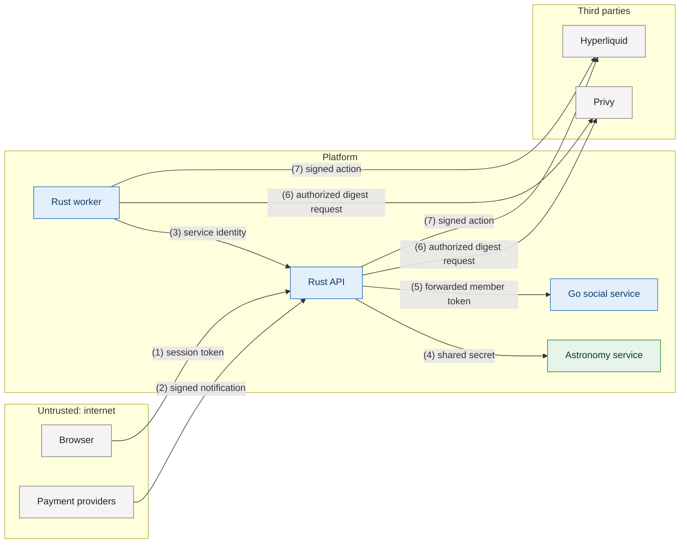
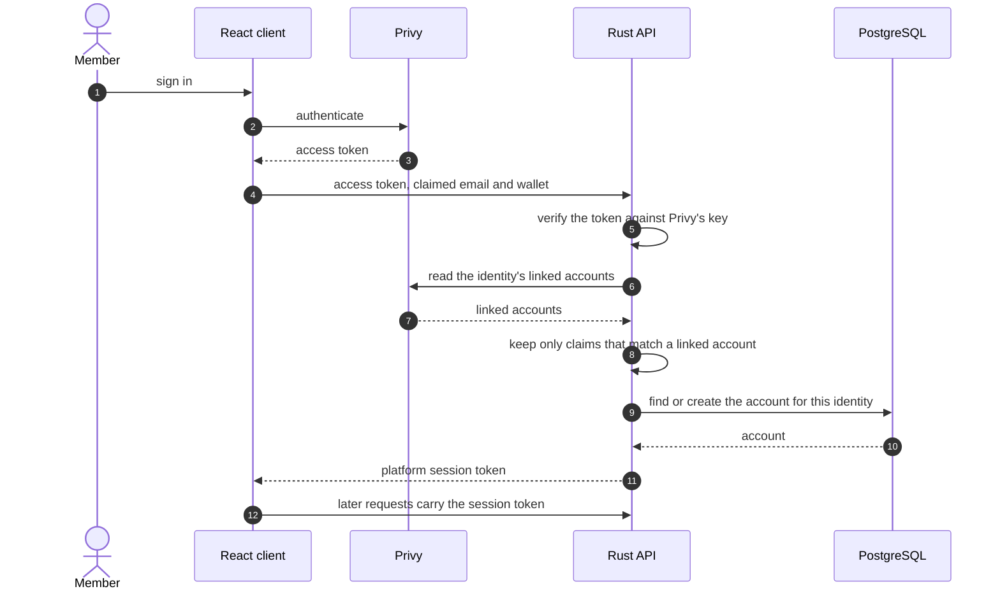
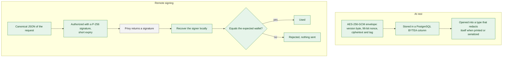
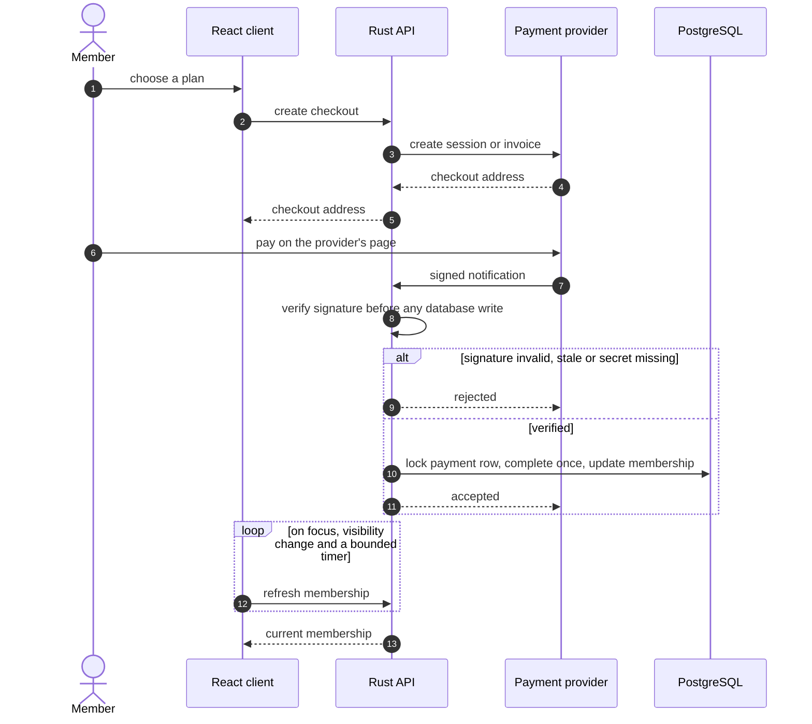
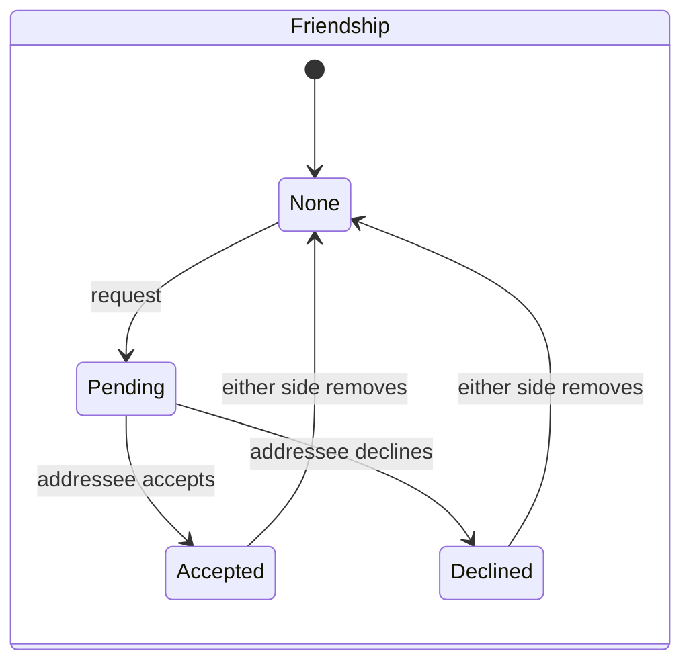
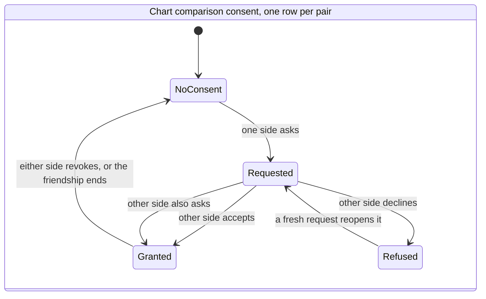

# Security model

How identity, payments, stored credentials and consent are handled in
production, and where the published code that implements each piece lives. For
the system overview see [ARCHITECTURE.md](ARCHITECTURE.md); for the trading
worker see [EXECUTION-SAFETY.md](EXECUTION-SAFETY.md). To report a
vulnerability, use the process in the root [SECURITY.md](../SECURITY.md).

The design rule throughout is that protection comes from secrets supplied at
deployment and from checks that fail closed, never from the source being
hidden. That is why the primitives can be published. This document describes
the source as deployed in November 2026; it is not a statement about any
deployment's network configuration.

## Trust boundaries

| # | Crossing | What is checked | Published in |
| --- | --- | --- | --- |
| 1 | Browser to API | Signed, expiring session token; a single `Authorization` header; a per-member quota | Described only |
| 2 | Provider to API | HMAC over the exact request bytes or canonical JSON, with a timestamp window where the provider supplies one | `platform-core/src/webhooks.rs` |
| 3 | Worker to API | A service identity distinct from any member; an invalid one is rejected outright and never falls back to a member identity | Described only |
| 4 | API to astronomy | Independent shared secret, size limits, quota and bounded CPU work | `services/ephemeris/src/main.rs` |
| 5 | API to social | The member's own token is forwarded and validated again by the social service | Described only |
| 6 | Platform to Privy | Each signing request is authorized by a P-256 signature over its canonical JSON and expires quickly | `platform-core/src/signing.rs` |
| 7 | Platform to exchange | Action hash and EIP-712 digest are built locally; a signature obtained from the remote signer is recovered and compared with the expected wallet before submission | `platform-core/src/signing.rs` |

The API signs and submits for actions a member initiates in the app; the worker
does so for automated trading. Both use the same published signing code.

The backend origin a service is configured with must be HTTPS or a
private-network host and may not embed credentials, and outbound clients do not
follow redirects.

## Identity and sessions

The diagram shows the Privy sign-in path, which is the one the product
presents. Privy establishes who the person is; the platform decides what that
identity may do.

- A claimed email or wallet is used only if Privy lists it as linked to that
  identity. The browser cannot assert its way into another account.
- An account already bound to one identity is never rebound to another.
- Membership is checked separately from authentication on every paid route,
  including downloads of content that was generated earlier
  (`platform-core/src/membership.rs`).

## Stored credentials and signing

What is published here is the format a stored credential is sealed in, and the
check applied to a signature before it is used. How credentials are provisioned
and moved between services is private and is not described.

The envelope exists in two languages (`platform-core/src/vault.rs`,
`go-primitives/vault`) tested with the same key and plaintext, and both still
read the older text layout, which is how a runtime migration can avoid
rewriting rows. In Go the decrypted value is a type whose `String`, `GoString`
and `MarshalJSON` all return a redaction marker, so it cannot reach a log line
or a JSON encoder by accident; in Rust it is a `SecretString`. Every use is an
explicit, greppable reveal.

The signature check matters most for the remote signer: a response from outside
the process is never trusted because of where it came from.

## Payments and membership

- Membership changes only on the server: from a verified provider notification,
  or from the server's own authenticated lookup with the provider when a member
  asks it to recover a payment. A return URL or a local UI switch cannot grant
  access.
- Completing a payment takes a row lock, so a repeated or concurrent
  notification completes it once.
- The Stripe check uses the exact received bytes and rejects a timestamp
  outside a short window. The NOWPayments check canonicalizes the JSON first,
  so key order cannot be used to forge or break a signature. Both return false
  when the secret is empty.
- The browser side is `frontend/src/utils/payment-access-watch.ts`: bounded
  polling, refresh on focus and visibility, and cleanup when the account
  changes.

## Fail-closed properties and the tests that pin them

Request authentication and rate limiting have their own private tests. The
properties below are the ones whose code and tests are published.

| Property | Test in `packages/platform-core` |
| --- | --- |
| A tampered ciphertext, a wrong version byte or a short blob does not decrypt | `vault::tests::v1_roundtrip_and_tampering` |
| Ciphertext from the earlier runtime decrypts without migration | `vault::compatibility::node_legacy_and_bytea_blobs_decrypt_without_migration` |
| A notification with a changed body, a stale timestamp or an empty secret is rejected | `webhooks::tests::stripe_requires_exact_bytes_and_fresh_timestamp` |
| Key order cannot change a notification's signature | `webhooks::tests::now_signature_is_order_independent_and_fails_closed` |
| An inactive, expired or unparseable subscription is not a subscription | `membership::tests::subscription_requires_active_status_and_unexpired_valid_date` |
| An action hashes and signs to the bytes recorded in the golden vectors | `signing_parity::matches_all_existing_sdk_golden_vectors` |
| A lease is exclusive, owner-checked and renewable only by its owner | `state::lease_is_exclusive_until_released_and_owner_checked`, `state::same_owner_renews_and_expired_lease_can_be_taken` |
| A nonce never repeats when the clock stalls or steps back | `state::nonce_never_repeats_when_the_clock_stalls_or_goes_back` |

## Social consent

Friendship and permission to compare charts are separate decisions with
separate state. The diagrams show the main transitions.

- A comparison runs only when the pair's consent is granted. Friendship alone
  is never enough.
- A declined comparison request is not revealed to the person who asked.
- Ending a friendship deletes the pair's consent in the same transaction, so a
  stale grant cannot silently unlock comparison again after re-friending.
  Either side can also revoke consent on its own at any time.
- Display names replace emails on every social surface; a member's email is
  never shown to another member.
- Realized profit and loss is never shown to a friend, whatever a stored
  display preference says.

The persistence for both state machines is published in
`packages/social-store`. The comparison itself and the HTTP layer are not.
